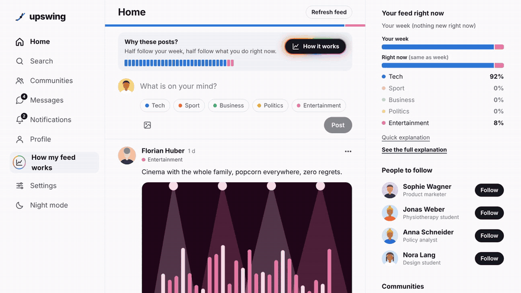
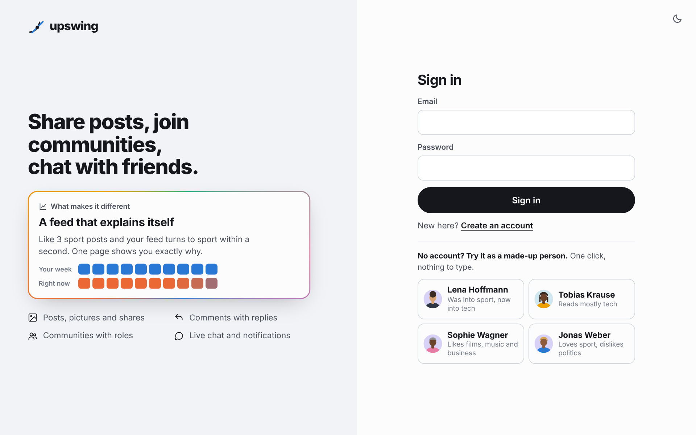
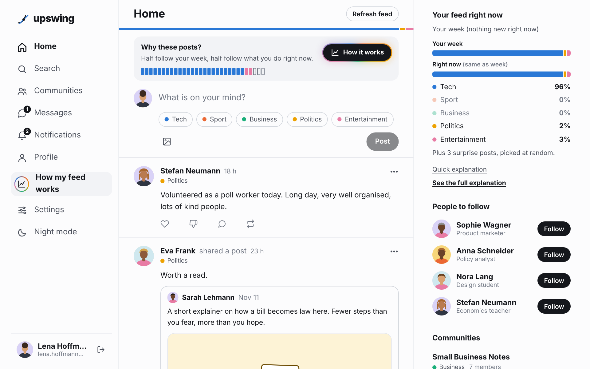
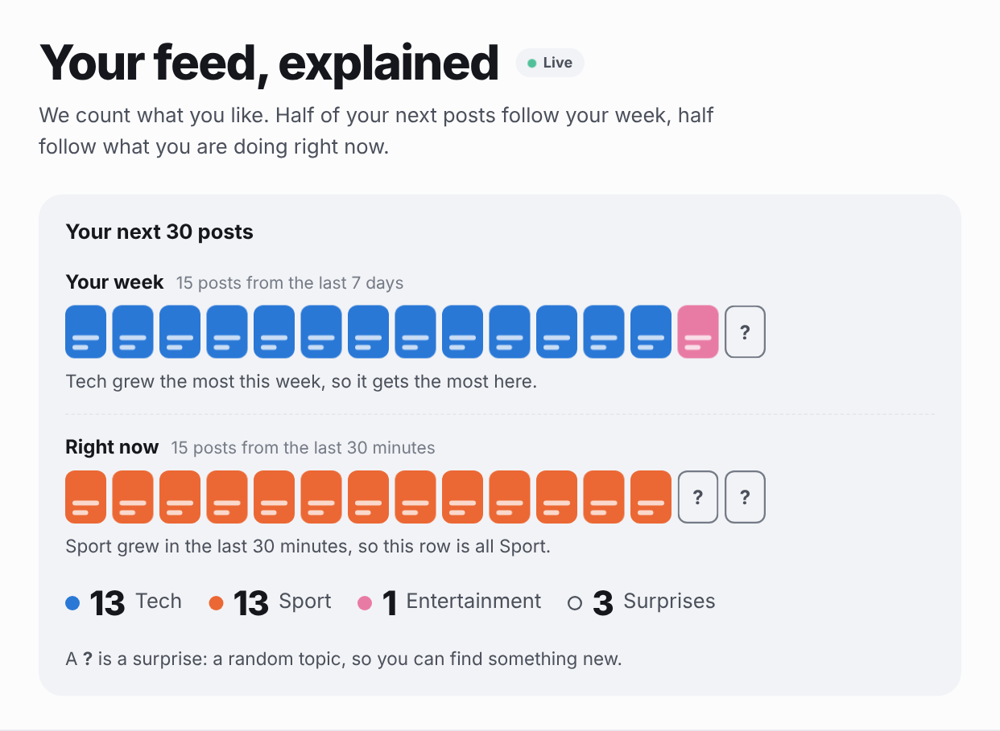
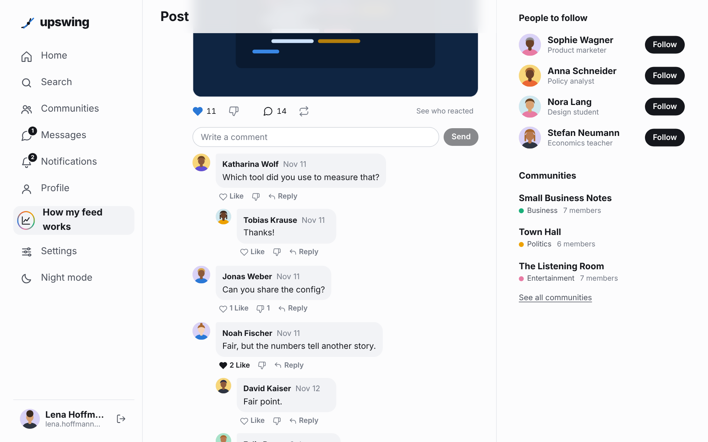
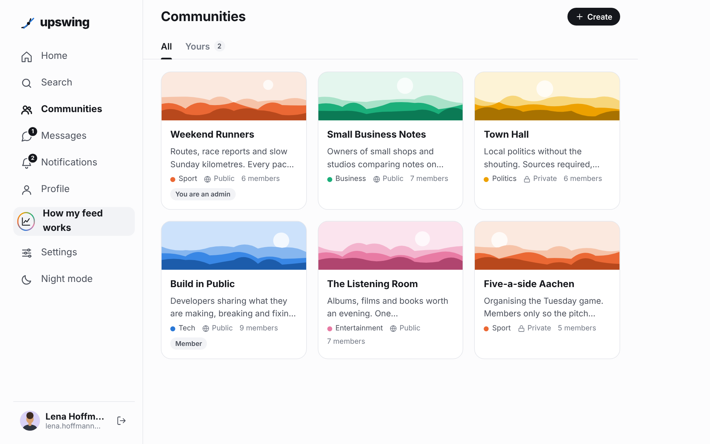
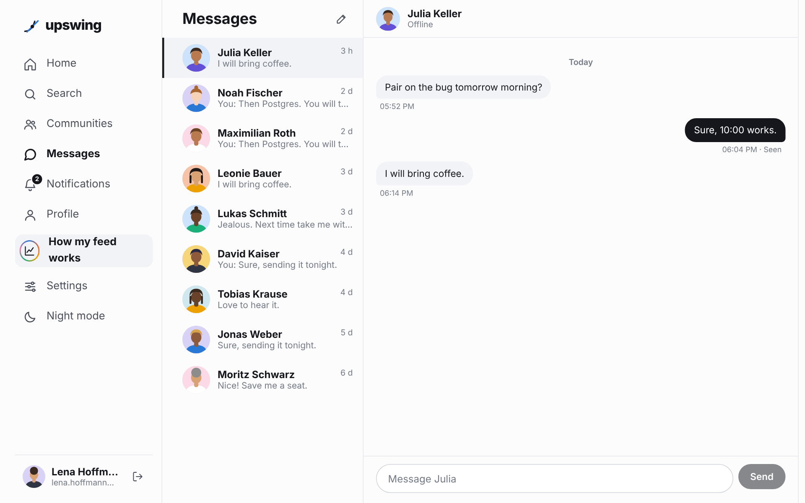
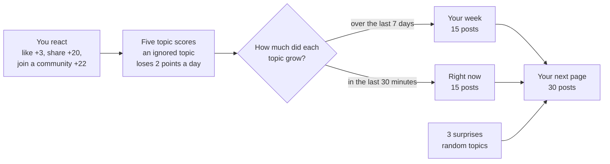
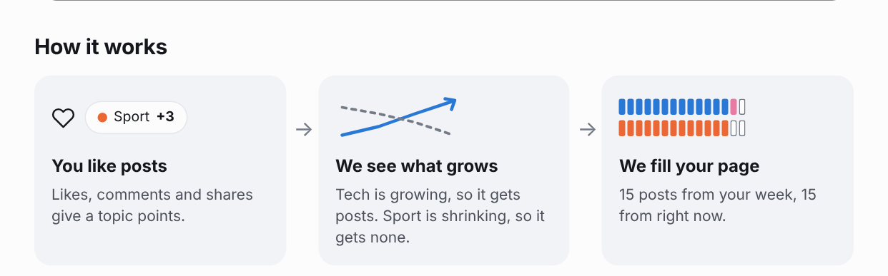
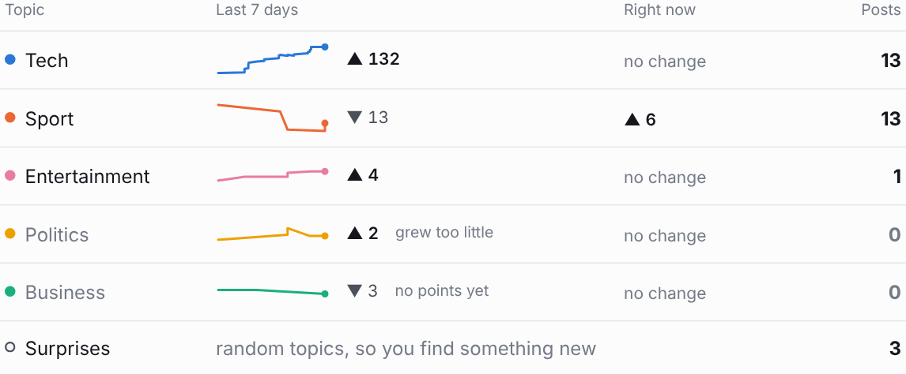

<div align="center">

# Upswing

**A social network whose feed explains itself.**

Posts, comments, communities and live chat, with a recommendation feed that follows what you are into right now, and a page that shows you exactly why you see each post.

[**▶ Try the live demo**][https://upswing-ulju.onrender.com/] &nbsp;·&nbsp; one click, no sign-up




</div>

## Try it in 30 seconds

1. Open the [**live demo**][live].
2. Under the sign-in form, click **Lena Hoffmann**. No account, no password.
3. Click **How it works** above her feed, then like 3 posts in the **Try it** box and watch her next posts change.

*Free hosting: if nobody has visited for a while, the first load takes about a minute.*

---

## At a glance

| | |
|---|---|
| **What** | A full social network: feed, posts with pictures, likes, shares, nested comments, follows, communities with roles, direct messages, notifications |
| **The interesting part** | A recommendation feed that follows how fast each of your interests is **growing**, not how big it is, and explains every page it sends |
| **Backend** | Node.js, Express, MongoDB (Mongoose), JWT, bcrypt, Multer, Socket.IO |
| **Front end** | React 18, Vite, React Router, plain CSS, hand-drawn SVG diagrams (no UI or chart library), light and night mode |
| **Deploy** | One service on Render (Express serves the React build) with MongoDB Atlas, or two services: see [the setup guide](docs/SETUP.md) |

## Features

- **Feed**: posts with pictures, likes and dislikes, shares, infinite scroll, a topic for every post
- **Comments** with nested replies, likes and dislikes on comments
- **Communities** with manager, admin and member roles, public and private, join requests
- **Live**: notifications, direct messages with typing and "Seen", who is online, all over Socket.IO, plus browser notifications when the tab is in the background
- **Profiles**, follows, search, settings, light and night mode, works on a phone
- **"How my feed works"**: every user sees why they get their posts, in plain words and small diagrams, and can change it live

| Sign in | Feed | Feed explained |
|---|---|---|
|  |  |  |
| **Nested comments** | **Communities** | **Live chat** |
|  |  |  |

---

## The feed algorithm

Most feeds show you more of what you already like the most. Upswing shows you more of what you are **getting into**: the topics whose score is climbing.



1. **Scores.** Every reaction adds points to the topic of the post (like +3, share +20, dislike −4). A topic you ignore loses 2 points a day.
2. **Growth, twice.** For each topic the server compares the score now with the score 7 days ago and 30 minutes ago (by linear interpolation between the stored points), so it gets two slopes.
3. **Two halves.** Half of the page follows your week, half follows what you do right now. In each half a topic gets `its growth ÷ the growth of all growing topics`, rounded to whole posts with the largest-remainder method so the half adds up exactly. **A shrinking topic gets nothing.**
4. **Surprises.** 3 of the 30 posts go to random topics you are not seeing (never to a shrinking one), so a feed that is all one topic can still change.
5. **Explained.** Every page that is sent is stored with its full calculation (`FeedLog`), and the "How my feed works" page draws it for the user.

| How it works, as the user sees it | One row per topic |
|---|---|
|  |  |

The code is in [`server/middleware/interestsMiddleware.js`](server/middleware/interestsMiddleware.js) (scores, slopes, halves, surprises) and [`server/controllers/postsRoute.js`](server/controllers/postsRoute.js) (building and logging each page).

---

## Engineering highlights

- **REST API** of about 80 endpoints for users, posts, comments, communities and messages, with JWT auth, bcrypt, role checks for community managers and admins, file uploads, and cascading deletes in model side-effect handlers.
- **Real time** with Socket.IO: one authenticated connection per tab carries notifications, messages, typing, presence and live updates of the feed mix.
- **A recruiter-friendly demo mode** (`DEMO_MODE=true`):
  - One click signs a visitor in as a made-up person, without a password, as a **private copy**. Two visitors never see each other's clicks.
  - Each copy is deleted after 3 hours, together with every like, follow and notification it made.
  - Writing is turned off for demo people on the server, not only in the interface.
  - The data reloads every 6 hours, and the sign-in page waits ("Getting the made-up people ready") instead of failing.
  - A made-up person's history moves to the moment of sign-in, so "5 minutes ago" stays 5 minutes ago.
- **Even seed data**: 28 made-up people, about 260 posts with generated pictures, 780 comments and 1,470 feed pages over 5 weeks. Every post gets exactly the same reactions (6 likes, 2 comments, 1 reply, 1 dislike), every comment 2 reactions, everybody 7 followers, and the pictures are drawn again from their names when a free host forgets its files.
- **One deployable service**: Express serves the React build, with a Render blueprint (`render.yaml`). A second blueprint deploys the front end and the API separately.

## Project structure

```
server/                 Node.js + Express + MongoDB + Socket.IO
  controllers/          route handlers (posts, comments, communities, users, messages, insights)
  middleware/           auth, permissions, the feed algorithm, demo mode
  models/               Mongoose schemas (user, post, comment, community, message, notification, feed log)
  realtime.js           Socket.IO: notifications, messages, typing, presence
  scripts/seed.js       the made-up people, posts and reactions
client/                 React 18 + Vite
  src/pages/            Home, Post, Communities, Messages, Profile, "How my feed works", ...
  src/components/       post card, comments, feed mix, small SVG charts and diagrams
docs/                   setup guide, screenshots, demo video
```

## Run it locally

You need Node.js 20 and a MongoDB database (a free [MongoDB Atlas](https://www.mongodb.com/cloud/atlas/register) one works).

```bash
git clone <this repository>
cd upswing
cp server/.env.example server/.env     # then put your DATABASE_URL and a JWT_SECRET in it
npm run setup                          # installs the server and the client
npm run seed                           # adds the made-up people, posts and reactions
npm run build && npm start             # open http://localhost:1000
```

On the sign-in page, click one of the four made-up people under the form. The [**setup guide**](docs/SETUP.md) explains every step for beginners, how to publish it for free, how the demo mode works, and the accounts and passwords of the made-up people.

---

## How this project was built

The backend is my first project, written before I used AI tools: the REST API, the communities and roles, and the feed algorithm (scores with time decay, interpolation, and a feed mixed by the slope of each interest).

Later I brought it back with [Claude](https://www.anthropic.com/claude) as a pair programmer. It reviewed and fixed the backend, replaced the Firebase features with Socket.IO, and built the React front end, the explanation page and the demo mode. Every backend line it changed carries a comment saying what and why, and [`CHANGES.md`](CHANGES.md) lists them all. The image-classification server (Python/Flask) and the original Firebase code were not written by me; they are kept in the code, commented out.

## About me

**Sami Khaleel**: full-stack developer in Jülich, Germany, open to junior full-stack and web developer roles.

- 📧 [sami000khaleel@gmail.com](mailto:sami000khaleel@gmail.com)
- 🐙 [github.com/sami000khaleel](https://github.com/sami000khaleel)
- 🎓 [TeachMe](https://teach-me-al46.onrender.com/home): live video classes in the browser (WebRTC, Socket.IO)
- 🧩 [Learn Languages](https://chromewebstore.google.com/detail/learn-languages-youtube-d/icbikjpimmfhofelddlfabbhpaombepm): a Chrome extension on the Chrome Web Store

[live]: https://YOUR-APP.onrender.com
